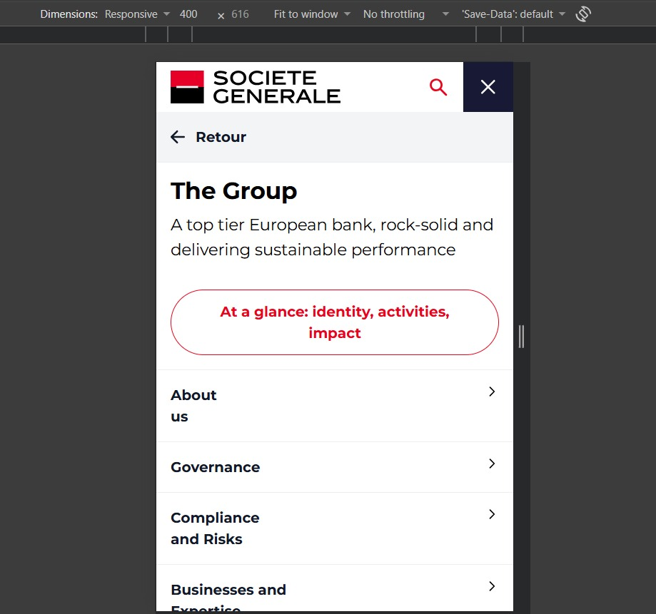

# Bug Reports: SG QA Portfolio

I found these bugs on the Société Générale homepage while testing it. I checked each one again on the live site before writing it down.

| ID | Summary | Severity | Requirement | Found by |
|---|---|---|---|---|
| BUG-1 | English share price label shows placeholder text instead of the price | Medium | R6 | Exploratory testing, confirmed by UI 5 |
| BUG-2 | Mobile menu back button says "Retour" on the English page | Low | R6 | Exploratory testing |

---

## BUG-1: English share price label shows placeholder text instead of the price

**Summary**
On the English homepage, the share price link in the header has an `aria-label` (the text a screen reader reads out) that still contains placeholders. The price, trend and change are never filled in, so a screen reader user hears "@ price" instead of the share price.

**Environment**
- Page: `https://www.societegenerale.com/en`
- Browser: Chrome 156 on Windows 10, 1920x1080 window
- Date: 6 November 2026

**Steps to reproduce**
1. Open `https://www.societegenerale.com/en` in a desktop-sized window.
2. Wait until the share price is shown in the header (for example `63.81`).
3. Right-click the share price and choose **Inspect**.
4. Look at the `aria-label` attribute of the share price link (`.header-menu-bourse a.cote-bourse`).

**Expected result**
The label contains the price shown on the page and no placeholder text, for example: `The stock market price is: 63.81 € ...`

**Actual result**
The label is:
`The stock market price is: @ price € with a @trend of @ diff%`

On `https://www.societegenerale.com/fr` the same label is filled in correctly, so the problem is only on the English page.

**Severity: Medium**
Sighted users still see the correct price, but screen reader users on the English site don't get the share price at all, and hear the placeholders read out instead.

**Evidence**
Test UI 5 (`UI 5: English share price label has no placeholder text`) fails on this bug. Output from my run on 6 November 2026:

```
Label should contain the price 63.81 but was: The stock market price is: @ price € with a @trend of @ diff%
Label should not contain @ placeholders but was: The stock market price is: @ price € with a @trend of @ diff%
```

I keep UI 5 failing on purpose until this bug is fixed (see the note in `TEST_CASES.md`).

---

## BUG-2: Mobile menu back button says "Retour" on the English page

**Summary**
On the English homepage, when the mobile menu is open and I go into a sub-menu, the button for going back is labelled in French ("Retour") instead of English.

**Environment**
- Page: `https://www.societegenerale.com/en`
- Browser: Chrome 156 on Windows 10, using Chrome's phone view (DevTools device toolbar). I didn't check it on a real phone.
- Date: 6 November 2026

**Steps to reproduce**
1. Open `https://www.societegenerale.com/en`.
2. Press **F12**, then **Ctrl+Shift+M** to switch to phone view, choose a phone, and reload the page.
3. Open the menu (☰).
4. Tap a menu item that has a sub-menu, for example "The Group".
5. Look at the back button at the top of the sub-menu.

**Expected result**
The button text is in English, for example "Back".

**Actual result**
The button text is "Retour".

**Severity: Low**
Users can still understand and use the button, but it's one word of French on the English site, so the page isn't fully translated (requirement R6).

**Evidence**
